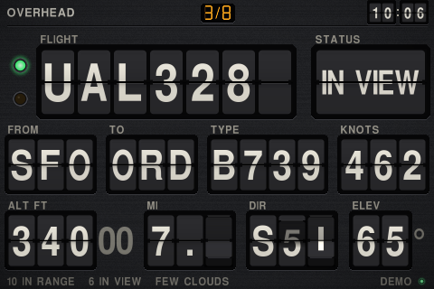
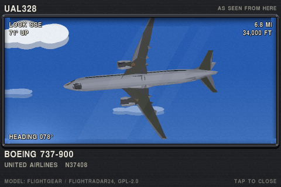
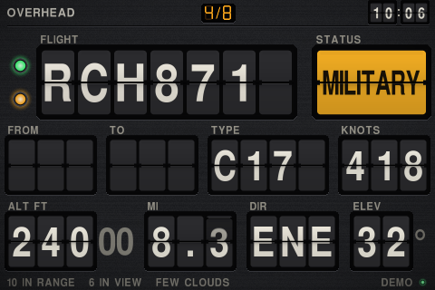
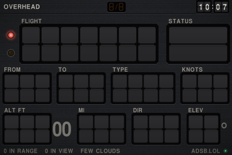
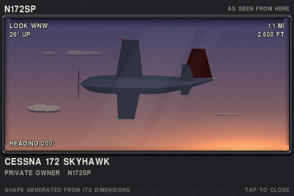
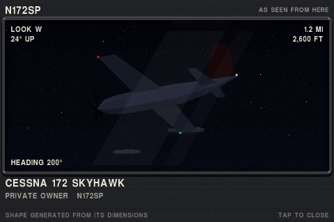
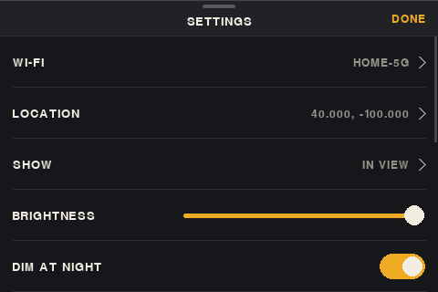

<div align="center">

# Overhead

**A split-flap board for the sky above your house.**

It shows the aircraft you could see from your window right now, one at a time,<br>
on a 3.5" touchscreen driven by a Raspberry Pi Zero.



[](https://github.com/mil-orb/overhead-ADSB/actions/workflows/ci.yml)


[](LICENSE)

</div>

## Why Overhead

- **It answers "what is that plane?"** Flight, route, type, speed, altitude, distance, which way to look and how far up.
- **It only shows what you can see.** Each aircraft is scored for your horizon, its size at that distance, haze, cloud and sun glare. A jet above an overcast doesn't make the card.
- **Military gets called out.** An amber flap, a blinking lamp, and it jumps the queue.
- **The flaps move like flaps.** Each one falls as a hinged plate under gravity, and drums only turn forward, so going from B to A takes the long way round.
- **Tap the card to see the plane.** A 3D model, posed the way the real one looks from where you stand, with its heading, climb and bank, against the sky as it is right now: the time of day, the sun or moon, the cloud cover.
- **No account, no key, no receiver.** Four free public data sources. Your coordinates are rounded to about 1 km before they leave the Pi.

The catch: it runs on a slow computer talking to the screen over SPI. A full change of aircraft repaints most of the screen and shows at about 8 updates a second at the default SPI speed. Small changes, like a distance ticking over, are smooth. [Limits](#limits) has the rest.

## What you get

<table>
<tr>
<td width="50%" valign="top">

**The card**

One aircraft fills the screen. The green lamp means you can see it now. The counter at the top shows which aircraft this is out of how many.

</td>
<td width="50%" valign="top">

**The plane view**

Tap the middle of the card. The model is shown along your line of sight to the aircraft, so one passing overhead shows its belly. Behind it is the sky in that direction, lit for the time of day.

</td>
</tr>
<tr>
<td></td>
<td></td>
</tr>
<tr>
<td width="50%" valign="top">

**Military**

An amber MILITARY flap and a blinking amber lamp. A new military aircraft takes over the card after 4 seconds.

</td>
<td width="50%" valign="top">

**Nothing to show**

Every flap goes blank and the lamp turns red. If the data feed is lost, the red lamp blinks and the flight flaps spell NO DATA.

</td>
</tr>
<tr>
<td></td>
<td></td>
</tr>
</table>

The same view at sunset and at night. The sun and moon are where they are in the real sky, the clouds follow the weather feed, and the aircraft shows its red, green and white lights after dark. Drag to look around it: down far enough and the ground comes into view.

<table>
<tr>
<td></td>
<td></td>
</tr>
</table>

## Will it work on my hardware?

| | |
|---|---|
| **Tested** | Raspberry Pi Zero W Rev 1.1, Raspberry Pi OS Lite 13 (trixie) 32-bit, Velleman VMP400 3.5" touchscreen (480 x 320, ILI9486 over SPI, ADS7846 resistive touch) |
| **Should work, untested** | Pi Zero 2 W and larger Pis. Other 3.5" SPI panels with the same two chips (Waveshare 3.5" A and its clones). Raspberry Pi OS Lite 12 (bookworm). |
| **Not supported** | Raspberry Pi OS 11 (bullseye) and older: its pygame is too old and it has no NetworkManager. |
| **On a PC** | Windows, macOS or Linux with Python 3.11+ and pygame, in a window, for trying it out. |

Other screen sizes lay out and run. Only 480 x 320 landscape has been looked at closely.

## Try it on a PC

```bash
python -m venv .venv
```

```bash
.venv/bin/python -m pip install -r requirements.txt
```

```bash
.venv/bin/python -m overhead --demo
```

On Windows the path is `.venv\Scripts\python`. `--demo` is simulated traffic with no network. Without it you get live traffic once a location is set, and demo traffic until then.

| Key | Does |
|---|---|
| Left, Right | Previous, next aircraft |
| V or Enter | Plane view |
| L or Space | Lock onto this aircraft |
| S | Settings |
| F | Fast-forward the flaps |
| Esc | Back, then quit |

The mouse works like a finger.

## Install on a Pi

Flash Raspberry Pi OS Lite (32-bit) with Raspberry Pi Imager, setting a hostname, user, Wi-Fi and SSH in its options. A Pi Zero only has 2.4 GHz Wi-Fi. Then on the Pi:

```bash
git clone https://github.com/mil-orb/overhead-ADSB && cd overhead-ADSB && bash pi/install.sh
```

```bash
sudo reboot
```

After the reboot it asks for three taps to calibrate the touch panel, then shows demo traffic until you set your location in settings. [docs/pi-setup.md](docs/pi-setup.md) explains each thing the installer changes, how to undo it, how to speed the screen up, and what to do if the screen stays white.

## Using it

| Touch | Does |
|---|---|
| Tap the left third | Previous aircraft |
| Tap the right third | Next aircraft |
| Tap the middle | Plane view. Tap again to close it, drag to look around the aircraft. |
| Press and hold | Lock onto this aircraft until it leaves the range. The counter blinks. Hold again to let go. |
| Swipe up from the lower half | Settings |

Every target is at least a third of the screen or 56 pixels tall, and nothing depends on reaching an edge, because the screen is small, resistive and sits in a case.

The card rotates through up to 8 aircraft, nearest first, 10 seconds each and 15 for the nearest. Distance, altitude, direction and elevation are recalculated twice a second from the aircraft's last reported speed and track.

**Status flap.** `IN VIEW`, `FAINT`, `INBOUND` (hidden now, should be visible within 6 minutes), `MILITARY`, `EMERGENCY` (squawk 7500, 7600 or 7700), or why it is hidden: `LOW`, `FAR`, `HAZE`, `CLOUD`, `GLARE`.

### Settings



| Setting | Choices |
|---|---|
| Wi-Fi | Scan, pick a network, type its password on the on-screen keyboard |
| Location | Latitude and longitude on a keypad |
| Show | Which aircraft go on the card. See below. |
| Brightness, dim at night | Software dimming. Night is when the sun is 4° below your horizon. |
| Distance | Miles, kilometres or nautical miles |
| Range | 5, 10, 15, 25 or 40 miles. Aircraft beyond it are ignored. Default 15. |
| Clock | 12 or 24 hour |
| Horizon | The lowest angle you can see, 0° to 20°. Default 5°. |
| Each plane | 6, 10, 15 or 30 seconds |
| Follow until gone | Stay on each aircraft until it leaves the range. No rotation. |
| Touch | Run the calibration again |
| Power | Restart the app, shut the Pi down |

**Show** picks the logic:

| Mode | The card shows |
|---|---|
| In view (default) | What you can see now, plus military and aircraft about to appear |
| Overhead | At least 55° up, or within 3 miles, visible or not |
| Approaching | Visible and getting closer by at least 15 m/s, or about to appear |
| Low flyers | Visible and below 10,000 ft above you |
| Military | Military and emergency aircraft in range, visible or not |
| Everything | Every aircraft in range |

`config.json` holds these plus a few that have no screen, such as `horizon_mask` for a building that blocks one direction. [config.example.json](config.example.json) lists them all.

## How it decides what you can see

Each aircraft's position is moved along its track to the present, then five factors are multiplied into a score from 0 to 1:

| Factor | Scores 0 | Scores 1 |
|---|---|---|
| Horizon | 1° below your horizon setting | 2° above it |
| Size by day | Wingspan under 2.5 arcminutes | Over 6. Above 8 km altitude it counts 1.6x, for the contrail. |
| Size at night | Farther than 75 km | Closer than 35 km |
| Haze | Sight line through the lowest 2 km of air longer than the reported visibility | Shorter than half of it |
| Cloud | A layer below the aircraft is overcast | No cloud below it |
| Sun glare | Within 6° of the sun | More than 18° from it |

0.55 or more is `IN VIEW`, 0.22 or more is `FAINT`. Both have hysteresis so an aircraft near a threshold doesn't flicker. [docs/visibility.md](docs/visibility.md) has the formulas and what they get wrong.

## The 3D models

36 aircraft are low-polygon conversions of open-source models: 34 from [Flightradar24's set](https://github.com/Flightradar24/fr24-3d-models), which is built on [FlightGear](https://www.flightgear.org)'s (GPL-2.0), and 2 from [amvlab](https://github.com/amvlab/aircraft-models) (CC BY 4.0). With close relatives sharing a model they cover about 80 types, including the 737, A320, 757, 767, 777, 787, A330, A350, E-jet and CRJ families. Everything else, including military types, most business jets and Cessnas, is drawn from a shape generated from that type's real length, wingspan and layout. The panel says which you are looking at. Credits and licenses are in [models/README.md](models/README.md).

Each model is about a thousand flat polygons, drawn by a small software renderer. A Pi Zero takes about 130 ms to draw one, so the picture is redrawn when the aircraft's attitude changes and not on every frame.

## Data sources

All free, no keys. Check their terms before any commercial use.

| What | From | How often |
|---|---|---|
| Aircraft positions | [adsb.lol](https://adsb.lol), falling back to [airplanes.live](https://airplanes.live) | Every 5 seconds |
| Routes and airline names | [adsbdb.com](https://www.adsbdb.com), cached on the Pi | Once per callsign |
| Cloud and visibility | [Open-Meteo](https://open-meteo.com) | Every 10 minutes |

Requests carry your coordinates rounded to 0.01 degree and nothing else about you. There is no server of ours and no telemetry.

## Limits

- **Screen speed.** At the installer's 16 MHz SPI clock the panel receives about 2,080 lines a second, so a full change of aircraft shows at about 8 updates a second. Raising the clock helps if your panel tolerates it: [docs/pi-setup.md](docs/pi-setup.md#a-faster-screen).
- **Visibility is an estimate.** It doesn't know your trees. Cloud layer heights are assumed at 500 m, 3 km and 8 km because the free weather feed doesn't give them.
- **Routes can be wrong.** They come from a callsign database. One the aircraft is nowhere near is dropped.
- **Coverage depends on volunteers.** Positions come from other people's receivers. Rural areas have gaps, and aircraft without ADS-B don't appear.
- **Dimming is software only** on this panel, which has no backlight control. Blacks stay slightly lit.
- **The sky in the plane view is drawn, not photographed.** It follows the sun, the moon and the reported cloud cover. The clouds are not where the real ones are, and the ground is generic fields, not your town.
- **No sound**, and the flaps don't bounce when they land.

## Development

```bash
python -m tests
```

runs everything in about 10 seconds, with no network and no screen. [CONTRIBUTING.md](CONTRIBUTING.md) covers setup and the rules, [docs/architecture.md](docs/architecture.md) the file map, [docs/flaps.md](docs/flaps.md) the animation and its speed budget. Coding assistants should start with [AGENTS.md](AGENTS.md).

## License

The code is [MIT](LICENSE). The converted aircraft models in `models/` keep their sources' licenses, GPL-2.0 and CC BY 4.0: [models/README.md](models/README.md).
