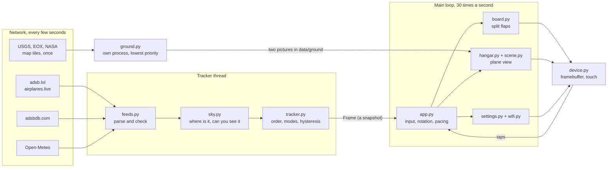

# Architecture

Overhead is about 6,500 lines of Python in thirteen files, plus pygame. It has two threads that matter: one fetches and scores aircraft every 5 seconds, the other draws. A third paints the plane view's sky, and once per location a separate process turns map tiles into the plane view's ground.

## The files

| File | What it does | Depends on |
|---|---|---|
| `overhead/sky.py` | Position of an aircraft in your sky (`locate`), the sun and moon, the visibility score, look-ahead for inbound aircraft. Pure math. | nothing |
| `overhead/feeds.py` | HTTP with size and time limits, the parser that every network record goes through, the route cache, weather, and the simulated traffic for `--demo` | `sky` |
| `overhead/tracker.py` | `Tracker.compute` turns a list of aircraft into a `Frame`: scored, filtered by the show mode and range, ordered. `Engine` runs it on a thread. | `sky`, `feeds` |
| `overhead/board.py` | The split-flap renderer: fonts, faces, drums, the pre-composed flip pictures, the layout solver, the lamp and the counter | pygame |
| `overhead/models.py` | Aircraft meshes: 213 generated from dimensions, 36 loaded from `models/*.json` | nothing |
| `overhead/scene.py` | The sky and ground behind the aircraft in the plane view, painted from the sun, moon and weather | `sky`, pygame |
| `overhead/ground.py` | Aerial photographs and night lights under the plane view's horizon: which tiles a location needs, checking and caching them, bending them into the panorama in a child process | `feeds`, pygame |
| `overhead/hangar.py` | The plane view: pose from live data, the software 3D renderer, the panel around it | `models`, `scene`, `board` |
| `overhead/settings.py` | The settings sheet: rows, pages, the keyboard and keypad, its own repaint tracking | `board` |
| `overhead/hints.py` | The touch tips screen, drawn once over a dimmed copy of the card | `board` |
| `overhead/wifi.py` | Scan and join through `nmcli`, or stand-in networks off the Pi | nothing |
| `overhead/device.py` | The Linux framebuffer and the evdev touch panel, read and written directly | pygame |
| `overhead/app.py` | Config, the main loop, input, which aircraft is on the card, frame pacing | everything |

`sky.py`, `feeds.py`, `tracker.py` and `models.py` never import pygame, so they can be tested and reused without a display.

## One aircraft's trip to the card

1. **Fetch.** Every 5 seconds the tracker thread asks adsb.lol for everything within a radius of your location, rounded to 0.01°. The radius is 1.6 times the range setting plus a margin, so aircraft about to come into range are already known. If adsb.lol fails it tries airplanes.live.
2. **Parse.** `parse_aircraft` turns one JSON record into a `Plane`, or drops it. Numbers must be finite and inside a sane range, the address must be six hex digits, and text is cut to a few printable characters. Nothing else in the program handles raw feed data.
3. **Score.** `assess` dead-reckons the aircraft to now, finds its range, bearing and elevation from you, and scores its visibility. See [visibility.md](visibility.md).
4. **Decide.** The tracker applies hysteresis to the score, looks ahead for aircraft that are hidden but closing, asks the route cache for origin and destination, applies the show mode and the range, and orders what is left. The result is a `Frame`, which is never changed after it is made.
5. **Hand over.** The main loop picks up the latest `Frame` when it wants one. There is one lock, around that single reference.
6. **Rotate.** `App.rotate` decides which aircraft in the frame is on the card: the current one until its time is up, then the next, with military and emergency aircraft jumping the queue.
7. **Keep it live.** Between frames, `App.live` re-computes the current aircraft's position twice a second from the same dead reckoning, so the distance and elevation flaps keep ticking.
8. **Flip.** `Board.set_card` gives each drum its new target. Each `Module` works out how many flaps it has to go through and starts releasing them.
9. **Draw.** `Board.update` advances every moving module by the elapsed time, copies the right pre-composed pictures onto the screen surface, and returns the rectangles it touched. See [flaps.md](flaps.md).
10. **Send.** On the Pi, `FbOut.push` copies those rectangles into a buffer and the framebuffer thread passes them on to the panel. In a window, pygame does it.

## Threads

| Thread | Does | Talks to the main loop through |
|---|---|---|
| Main | Input, animation, all drawing to the screen | |
| Tracker (`Engine`) | Network, parsing, scoring, every 5 s | One reference to the latest `Frame`, behind a lock |
| Routes | Looks up callsigns at adsbdb, one a second | Its cache dict, behind a lock |
| Board warm-up | Composes the flip pictures after start | Fills a dict the renderer reads. Each entry is complete before it is stored. |
| Scene | Paints the sky panorama when the light changes | Swaps one reference when the picture is finished |
| Model | Loads the 3D model for the aircraft on the card, once per type, so the plane view opens without the wait | The models module's cache dict. Each model is complete before it is stored. |
| Framebuffer (Pi only) | Copies changed lines into `/dev/fb1` | A buffer and a list of changed bands, behind a lock held only for memory copies |
| Touch | Blocks on the touch device, turns packets into taps | A queue |
| Wi-Fi worker | Runs `nmcli` for a scan or a join | A result slot the settings sheet polls |
| Ground (a process) | `python -m overhead.ground`, started once per location at the lowest CPU priority: fetches map tiles and bends them into two pictures | Files in `data/ground`, which the Scene thread loads when they appear |

Nothing on the main thread waits for the network, the disk or a subprocess.

## Drawing and the screen

Everything draws onto one surface in the screen's own pixel format, and every draw call reports the rectangles it changed. That discipline exists because of the display: the panel is on SPI and receives about 2,080 lines a second, so a repaint of the whole screen takes 150 ms to arrive however fast it was drawn.

- **The board** redraws only modules that are moving.
- **The settings sheet** uses a "reveal" motion: the rows stay where they are and the header bar travels over them, so each frame repaints a thin band. A sheet that slid as a whole would repaint everything it covers every frame.
- **The plane view** wipes down the same way, and after that only its window is redrawn, and only when the aircraft's attitude changes.
- **`App.run`** measures the lines it is sending and holds the frame rate to what the link carries.

On the Pi there is no X, no Wayland and no SDL video driver. `device.py` memory-maps `/dev/fb1` and copies changed bands in, and reads touch packets straight from `/dev/input/event*`, applying a three-point calibration. That keeps the whole thing to one process using about 60 MB of a Pi Zero's 512.

A write into the framebuffer waits whenever the panel driver is still sending the last picture, up to 160 ms at 16 MHz. A plain Python copy holds the interpreter lock through that wait, which used to freeze the main loop and every other thread with it. So `FbOut.push` only copies the changed bands into a buffer in ordinary memory (about 1.5 ms for a full card flip on a Pi Zero), and a thread moves them on with `ctypes.memmove`, which lets go of the lock while it waits. Bands pushed while that thread is waiting are merged into its next copy. The cost is two extra memory copies, about 4 ms of CPU per full-flip frame.

While another thread is busy (the sky painting, mostly), the main loop has to win the interpreter lock back after every blit. `App.run` sets Python's switch interval to 1 ms instead of 5, which took a card frame during a sky paint from a median 73 ms to 30 ms on a Pi Zero.

## The plane view

`hangar.pose` builds a matrix from five live numbers: the aircraft's track, climb angle and roll, and the bearing and elevation of your line of sight to it. The model is then drawn as you would see it: belly-up when it is overhead, side-on when it is low and crossing.

`hangar.render` is a painter's-algorithm renderer in plain Python: project the points, drop faces that look away, sort the rest far to near, fill each as a flat polygon. Each face is shaded from the average normal of the faces around it, which makes a thousand triangles read as a smooth skin. The model is drawn at twice the size and averaged down to take the stair-steps off edges. On a Pi Zero that is about 130 ms, or 70 ms without the smoothing while a finger is dragging.

`scene.py` paints the sky and ground once, as a panorama of every direction, on its own thread (about 3 seconds on a Pi Zero). Showing any direction is then one copy of a window from it, which takes about a millisecond. It is repainted when the sun has moved a degree near sunrise or sunset, or the weather has changed. Nothing in it may hold the interpreter lock for long: the clouds are laid on 48 rows at a time, because one blit of the whole layer froze the card for half a second.

While the plane view is closed, the app only gets it ready: the sky starts painting and the aircraft's model loads on a thread. The picture is drawn when you open it. It slides in with the 1:1 picture, the one used while dragging, and the smoothed one replaces it when the slide stops.

The clouds are two sheets of noise, low cumulus and high cirrus, each laid out flat at a fixed height and seen from below, so clouds overhead are large and the ones near the horizon small and flat. That field is built once (about 0.2 s on a PC, 6 s on a Pi Zero) and kept in `data/`, under a name that carries a hash of the code that makes it, so a change to that code builds a new one. Each repaint turns the weather's cover fractions into thresholds and runs the field through byte lookup tables, so it is C work inside pygame, about 20 ms on a PC.

With a location set, `ground.py` replaces the drawn fields with aerial photographs. It works out which map tiles cover the land up to 72 km out, at the detail each row of the panorama can show, fetches them once, and bends them into panorama rows as seen from 500 m up, allowing for the curve of the earth. Those two pictures (by day and the lights at night) are made in a separate low-priority process so the board keeps its frame rate, and kept in `data/ground`. Each repaint only tints them for the light, fades them out of season and lays on haze row by row.

## Configuration

`config.json` in the repo folder, created the first time a setting is changed. `DEFAULTS` in `app.py` lists every key. Only those keys are saved. The file is written to a temporary name and renamed, so a power cut can't leave half a file.

It holds your coordinates, so it is in `.gitignore` and `tools/pi.py deploy` never copies it.

## Tests

`python -m tests` runs seven plain scripts of assertions in about 10 seconds on a PC, with no network and no screen.

| File | Covers |
|---|---|
| `test_sky.py` | Geometry against the exact formulas, sun and moon, each visibility factor, the tracker's order, modes and range |
| `test_feeds.py` | Hostile and broken responses: NaN, infinity, wrong types, control characters, floods, a slow or oversized body, a damaged cache file, odd Wi-Fi names |
| `test_models.py` | Every generated type builds with its real proportions, every converted model loads with its license, the pose math, the renderer |
| `test_scene.py` | Sky colours by time of day, the light on the aircraft, the panorama's seam, cloud cover against the weather at every height, the background painting |
| `test_ground.py` | Image headers and hostile tiles, which tiles a location asks for, that north stays north and distances land on the right rows, building from a cache and offline |
| `test_device.py` | Framebuffer band copying against a file, touch packet decoding, calibration |
| `test_ui.py` | The real app, driven headless: rotation, taps, the settings sheet, joining a stand-in network, the plane view |
